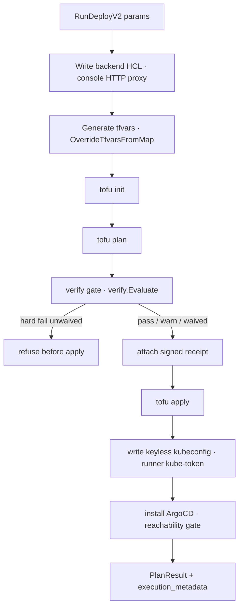

<!-- Moved out of the user docs (apps/docs, /runner/core) by #5240: contributor material. -->

_Shared Go packages used by both the alethia CLI and the runner agent._

# core Library

`packages/core/` is a shared Go module imported by both the alethia CLI and the runner. It holds the
provisioning orchestration, the cloud-provider abstraction, the OpenTofu wrapper, and the Elench
verify/drift engines — so both callers use identical logic.

## Package map

| Package | Purpose |
|---------|---------|
| `api/` | HTTP client for the Alethia control plane (runner + Bearer auth) |
| `provisioner/` | Orchestrates deploy, destroy, drift, import, and probe workflows (`RunDeployV2`, `RunDestroy`, `RunDriftDetection`, `RunStateImport`, `RunProbe`) |
| `tofu/` | Wrapper around the `tofu` binary via `hashicorp/terraform-exec` |
| `cloud/` | `CloudProvider` interface + per-cloud implementations, the HTTP state backend, and kubeconfig writing |
| `verify/` | The deterministic, fail-closed Elench policy gate over the plan JSON (+ ed25519 evidence receipt) |
| `drift/` | Turns `tofu plan -refresh-only -json` into a per-environment drift `Posture` |
| `sandbox/` | The per-job isolation seam (Passthrough / Container backends) |
| `argocd/` | ArgoCD install, manifest rendering, infra facts |
| `k8s/` | kubeconfig management |
| `git/` | Git clone, checkout, commit, push |
| `infracost/` | Infracost CLI wrapper and JSON output parser |
| `accessanalyzer/` | AWS IAM Access Analyzer corroboration for the verify gate (opt-in) |
| `scanner/` / `iacsafety/` | Static scanning of bring-your-own charts + IaC |
| `catalog/` / `categories/` / `manifests/` | Add-on catalog, component categories, rendered manifests |
| `types/` | `ProjectConfig`, `CloudIdentity`, and shared structs |
| `state/` | tofu state handling |
| `telemetry/` · `utils/` · `assets/` | OTel spans; logger/CLI/file helpers; embedded templates (`go:embed`) |

## Key packages

### provisioner/

The main orchestration layer. Entry point: `RunDeployV2()`.



`RunDeployV2` is the fail-closed spine: it evaluates the plan JSON with `verify.Evaluate`, refuses
the apply if a hard control is failing and unwaived (`gateRequiresReport` + `Report.Unwaived`), and
seals a `verify.SignedReceipt`. Also exposes `RunDestroy()`, `RunDriftDetection()`, `RunStateImport()`,
and `RunProbe()`. Brownfield attach
is handled here: a component marked "existing" injects the resource id (`vpc_id` / `network_id` /
`vnet_id`) as a tfvar instead of creating one.

### tofu/

Drives the `tofu` binary through `hashicorp/terraform-exec/tfexec` (state- and CLI-compatible with
the Terraform 1.6 HCL line, hence the legacy library name):

- `NewTofuCLI()` — construct against a workdir with stage-aware graceful cancellation (SIGINT to the
  `tofu` child on ctx-done, then a grace period)
- `Init()` / `InitWithBackendFile()` — init with backend config (the console HTTP backend file)
- `Plan()` / `PlanRefreshOnly()` — plan, or refresh-only for drift detection
- `Apply()` / `Destroy()` — apply a plan file / destroy
- `ShowPlanJSON()` — the structured plan JSON the UI diff and verify gate consume
- `OverrideTfvarsFromMap()` — materialize a tfvars file from `ProviderTfvars`

The `tofu` binary is **baked into the runner image** (SHA-verified), so no binary is downloaded at
provision time.

### cloud/

Defines the `CloudProvider` interface:

```go
type CloudProvider interface {
    Name() string
    RequiredCLIs() []string
    ProviderTfvars(config *types.ProjectConfig) map[string]interface{}
    ConfigureKubeconfig(ctx context.Context, config *types.ProjectConfig, outputs map[string]interface{}, stdout io.Writer) error
}
```

Implementations are provisioning-only — the runner no longer lists cloud resources; the Console
maintains the [asset inventory](https://alethialabs.io/docs/guides/connectors/health-and-inventory) server-side:

- `aws_provider.go` — AWS EKS kubeconfig (describe-cluster → exec-credential kubeconfig that invokes
  `runner kube-token`). Keyless `AssumeRoleWithWebIdentity` lives in the runner agent, Access Analyzer
  in `accessanalyzer/`, and EC2 subnet lookup in `cloud/aws/` — not this file
- `gcp_provider.go` — GCP Workload Identity Federation + kubeconfig
- `azure_provider.go` — Azure federated identity + kubeconfig (`azidentity`)
- `alibaba_provider.go` — Alibaba RAM `AssumeRoleWithOIDC`
- `hetzner_provider.go` — Hetzner token auth + Talos kubeconfig (`RequiredCLIs` empty — CLI-free)
- `http_backend.go` — the **Console HTTP state backend** (`backend "http"`, per-job token via
  `TF_HTTP_PASSWORD`) — there is no S3 storage credential on the runner
- `kubeconfig.go` — writes the exec-credential kubeconfig that invokes `runner kube-token`

### verify/ & drift/

`verify` is the deterministic, engine-agnostic policy gate (keyless / least-privilege / OIDC-subject
controls, honest `not_evaluable`, ed25519 receipt). `drift` turns a refresh-only plan into a per-env
`Posture`. See [Engine internals](https://alethialabs.io/docs/concepts/elench/engine-internals) and `packages/core/verify/README.md`.

### infracost/

- `CheckToken()` — validates the API key
- `ensureBinary()` — downloads infracost if missing
- `RunInfracost()` — executes `infracost breakdown` on the plan JSON
- `parse.go` / `types.go` — parses into `CostBreakdown` / `CostResource`

### argocd/

- `argocd/install.go` — applies rendered Application manifests, external-DNS secret, repo credentials
- `argocd/render.go` — renders Application manifests from templates with infra facts
- `argocd/infra_facts.go` — extracts cluster info, DB/cache endpoints from tofu outputs

ArgoCD itself is installed by the provisioner (`installArgoCD` in `provisioner/deploy.go`) via a
`helm upgrade --install argo-cd` shell command — there is no standalone `helm/` Go package.

### assets/

Uses Go's `embed` directive to ship templates inside the binary — the runner is self-contained:

```go
//go:embed all:tofu/seed
//go:embed all:helm/runner
var Assets embed.FS
```

## Adding a pluggable connector

Moved here from the user docs (`guides/connectors/pluggable`). A new provider needs no change to
routes, the runner core or the form engine:

1. Add a row to `packages/core/categories/catalog.json`: category, slug, `auth_method`, icon, and the
   credential and provider-config fields. Set `icon_url` to a path under `packages/assets/static`
   (the convention is `/icons/<slug>/<slug>-32x32.png`) after committing the file there, or to `null`
   for a monogram tile. A path with no file behind it fails step 4.
2. Add a `CategoryProvider` Go implementation under `packages/core/categories/` (`Tfvars`,
   `Validate`).
3. Add the OpenTofu module under `infra/templates/categories/<category>/<slug>/`. A chart-repository
   provider has no module: it implements `RepoCred`, and needs a host rule in
   `apps/console/lib/connectors/helm-registry-hosts.ts` so that the console resolves the same
   credential URL as the Go provider.
4. Run `pnpm -F console gen:connectors` to regenerate the registry and the catalog seed. It fails,
   naming the connector, when an `icon_url` does not resolve to a committed file.
