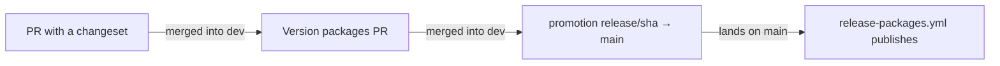

<!--
SPDX-FileCopyrightText: 2026 Alethia Labs <legal@alethialabs.io>
SPDX-License-Identifier: AGPL-3.0-only
-->

# Releasing the shared packages to npm

Some workspace packages are published to npm as `@alethialabs/*`, because Alethia Labs' private
applications install them. Inside this repository they keep their `@repo/*` names, ship raw
TypeScript and are imported exactly as before; nothing about day-to-day work changes except one
line per PR, below.

## What is published

`packages/public-packages.json` lists the packages. A published package may depend only on other
published packages; CI refuses anything else. Today: `brand`, `email`, `format`, `legal`,
`org-slug`, `platform`, `privacy`, `support`, `ui`.

To publish another package, add it to that file in a PR (with a changeset for it).

## When you change one: add a changeset

A PR that changes what a published package ships (its `src/`, `package.json` or `README.md`; not its
tests or configs) needs a changeset, and the `A change to a published package carries a changeset`
step in CI fails without one.

```bash
pnpm changeset
```

Choose the package, the bump, and write one line for the changelog. Or write the file by hand:

```markdown
<!-- .changeset/any-name.md -->
---
"@repo/ui": patch
---

The date picker no longer shifts by a day in UTC+ time zones.
```

Bumps follow semver from the consumer's side: `patch` for a fix, `minor` for something new that
breaks nobody, `major` for a removal or a changed signature.

## How a release happens



1. **Version packages PR.** On every push to `dev` that adds changesets,
   `.github/workflows/version-packages.yml` opens or updates one PR into `dev` that bumps the
   versions and writes each package's `CHANGELOG.md`. It is reviewed and queued like any other PR.
2. **Promotion.** The next promotion carries the bumped versions to `main`.
3. **Publish.** `.github/workflows/release-packages.yml` runs on `main`: it builds every published
   package (`scripts/release/stage-public-packages.mjs`), then publishes each version that is not on
   npm yet (`scripts/release/publish-public-packages.mjs`), with a provenance statement linking the
   tarball to the commit and workflow that built it. Versions already on npm are skipped, so the
   workflow can be re-run safely.

## What the published package looks like

The staging script turns `packages/<name>` into `.release/packages/<name>`:

- `dist/` holds ES modules and `.d.ts` files, compiled by the package's own TypeScript in bundler
  mode. `"use client"` prologues are kept. CSS and fonts under `src/` are copied next to them.
- `src/` is shipped too for `shipSource` packages (`brand`, `privacy`, `ui`), so a consumer's
  Tailwind can scan `node_modules/@alethialabs/ui/src`.
- `package.json` gets the public name, the real version, `exports` that point at `dist/`, and
  `@repo/*` dependencies renamed to `@alethialabs/*` at `^<version>`.
- The licence is AGPL-3.0-only, as everywhere in this repository outside `ee/`.

Check it locally before a release with `pnpm release:pack` (it builds, stages and runs
`npm publish --dry-run`; nothing is uploaded).

`@alethialabs/brand` uses `next/font/local`, so a consuming Next.js app must list it in
`transpilePackages`.

## Authentication

The release job authenticates with npm **trusted publishing**: npm trusts this repository's
`release-packages.yml` workflow by its OIDC identity, so no npm token is stored anywhere. Every
published package has the trusted publisher set on npmjs.com: GitHub Actions,
`alethialabs-io/alethialabs`, workflow `release-packages.yml`, environment `npm-release`, with
"Allow npm publish" ticked.

A package can only get a trusted publisher once it exists on npm, so a NEW package's very first
release needs a token. Create a short-lived granular npm token, store it as `NPM_TOKEN` in the
`npm-release` environment (which only `main` can read), and add
`NODE_AUTH_TOKEN: ${{ secrets.NPM_TOKEN }}` to the publish step for that one release. Then set the
new package's trusted publisher, remove the line, delete the secret and revoke the token.
